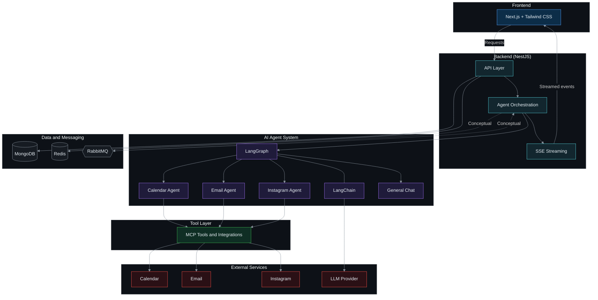

<div align="center">

# Sutra

**Delegate everyday digital tasks to specialized AI agents using natural language.**


</div>

---

## Introduction

Sutra is an AI-powered automation and productivity platform built around specialized AI agents. Instead of switching between calendars, inboxes, and social media tools, you describe what you want in plain language and Sutra's agents carry out the work. It also includes a general-purpose conversational assistant for everyday questions.

> **Project status:** Sutra includes working application paths for authenticated chat, LangGraph routing, persistent conversations/checkpoints, MCP-backed actions, and durable approval gates. Live provider use still depends on correctly configured credentials, public media hosting, Meta permissions, and deployment hardening.

## Table of Contents

- [Overview](#overview)
- [Features](#features)
- [How It Works](#how-it-works)
- [Architecture](#architecture)
- [Technology Stack](#technology-stack)
- [Project Structure](#project-structure)
- [Getting Started](#getting-started)
- [Development Status](#development-status)
- [Roadmap](#roadmap)
- [Contributing](#contributing)
- [License](#license)

## Overview

### The problem

Routine digital work is fragmented. Scheduling a meeting means checking a calendar, drafting an email, and confirming details across several applications. Publishing a social media post means writing copy, formatting it, and using yet another tool. Each task is small, but the context switching adds up.

### The approach

Sutra treats these tasks as delegable. A user describes an outcome in natural language, and the platform routes the request to a specialized agent that has access to the tools it needs. Each agent focuses on one domain (calendar, email, Instagram), which keeps its behavior scoped and its tool access explicit.

## Features

> Feature code is implemented; external provider operations require credentials and permissions.
>
> Legend: ✅ Implemented · 🚧 In development · 🗓️ Planned

### 🤖 AI Agent System

- Specialized agents for distinct task domains
- Natural-language task execution
- Agent orchestration and workflow coordination
- Context-aware interactions

### 📅 Calendar and Meeting Automation

- Create and manage calendar events
- Schedule meetings from natural-language instructions
- Assist with meeting arrangements

### 📸 Instagram Automation

- Generate Instagram post content with AI
- Automate publishing workflows
- Delegate social media tasks to an agent

### ✉️ Email Automation

- Compose emails with AI
- Send emails from natural-language instructions
- Automate email-related workflows

### 💬 General AI Chat

- Conversational assistant for general questions
- Entry point to the platform's agent ecosystem

### Feature status

| Feature | Status |
| --- | --- |
| Agent CRUD and ownership scoped listing | Partial |
| Google and Meta OAuth connection setup | Partial; credentials and provider review required |
| Integration connection status and disconnect | Implemented in API |
| Real AI chat and SSE | Implemented through the gateway and LangGraph service |
| Gmail, Calendar, Instagram actions and approvals | Implemented with server-side OAuth and persistent approval gates |
| Persistent conversation and activity history | Implemented using shared `libs/db` MongoDB setup |
| Uploads and Instagram media preparation | JPEG/PNG/MP4 uploads; Instagram publishing requires public HTTPS media access |

## How It Works

At a high level, Sutra connects four layers:

1. **User interface.** The user sends an instruction through the web client, for example a request to schedule a meeting or draft an email.
2. **Backend.** The API receives the request, manages the conversation, and hands the task to the agent system.
3. **Agents.** Specialized agents, built with LangChain and orchestrated with LangGraph, decide which steps and tools are needed to complete the task.
4. **Tools and external services.** Agents reach external services through tools, which may be exposed via the Model Context Protocol.

### Agent orchestration with LangGraph

LangGraph models agent behavior as a graph of steps and state. A task can move through stages such as interpreting the request, selecting a tool, executing it, and responding, with state carried between steps. This structure allows multi-step workflows to be coordinated and inspected rather than handled as a single opaque prompt.

### Tool access with MCP

The Model Context Protocol provides a standard way for agents to discover and call tools. In Sutra, MCP is intended to be the connection layer between agents and external capabilities such as calendar, email, and Instagram integrations.

### Streaming responses

Server-Sent Events (SSE) stream responses and progress updates from the backend to the client, so users see output as it is produced.

> Specific orchestration flows, graph definitions, and tool contracts will be documented as they are finalized.

## Architecture

The diagram below shows the current service boundaries and request flow.



### Component notes

| Component | Role in Sutra                                                         |
| --------- | --------------------------------------------------------------------- |
| Next.js   | Web client for chat and agent interaction                             |
| NestJS    | Backend API, request handling, and orchestration entry point          |
| LangChain | LLM and tool abstractions used by agents                              |
| LangGraph | Stateful orchestration of multi-step agent workflows                  |
| MCP       | Standard interface between agents and external tools                  |
| MongoDB   | Persistent storage (for example conversations and user data)          |
| Redis     | SSE progress fan-out and request rate limiting                        |
| RabbitMQ  | Requests between the gateway, user service, and agent service        |
| SSE       | One-way streaming of responses and progress to the client             |

## Technology Stack

### Frontend

| Technology   | Purpose                            |
| ------------ | ---------------------------------- |
| Next.js      | React framework for the web client |
| TypeScript   | Type-safe development              |
| Tailwind CSS | Utility-first styling              |

### Backend

| Technology | Purpose                                           |
| ---------- | ------------------------------------------------- |
| NestJS     | Modular server-side framework                     |
| TypeScript | Shared language across the stack                  |
| Nx         | Monorepo tooling, task running, and project graph |

### AI and Agent Architecture

| Technology | Purpose                                                   |
| ---------- | --------------------------------------------------------- |
| LangChain  | LLM integration and tool abstractions                     |
| LangGraph  | Graph-based agent orchestration and state management      |
| MCP        | Standardized connection between agents and external tools |

### Database and Caching

| Technology | Purpose                     |
| ---------- | --------------------------- |
| MongoDB    | Primary document database   |
| Redis      | Caching and ephemeral state |

### Messaging and Real-Time Communication

| Technology | Purpose                                   |
| ---------- | ----------------------------------------- |
| RabbitMQ   | Message broker for asynchronous workloads |
| SSE        | Streaming responses from server to client |

### Infrastructure

| Technology | Purpose                                            |
| ---------- | -------------------------------------------------- |
| Docker     | Containerization and consistent local environments |

## Project Structure

Sutra is organized as an Nx monorepo.

```text
sutra/
├── apps/
│   ├── web/                  # Next.js frontend
│   ├── gateway/              # NestJS API gateway (entry point for client requests)
│   ├── users/                # NestJS users service
│   └── agents/               # NestJS AI agents service (LangChain, LangGraph, MCP)
├── libs/
│   ├── shared/               # Shared types, constants, and utilities
│   ├── db/                   # MongoDB connection, schemas, and repositories
│   ├── redis/                # Redis module and caching utilities
│   └── filters/              # Shared exception filters
├── docker/                   # Docker-related configuration
├── docs/                     # Additional documentation
├── nx.json
├── package.json
└── README.md
```

| Path            | Description                                                      |
| --------------- | ---------------------------------------------------------------- |
| `apps/web`      | Next.js client for chat and agent interaction                    |
| `apps/gateway`  | Single entry point that receives client requests                 |
| `apps/users`    | User-related functionality                                       |
| `apps/agents`   | AI agent system built with LangChain, LangGraph, and MCP         |
| `libs/shared`   | Code shared across applications                                  |
| `libs/db`       | Database access layer for MongoDB                                |
| `libs/redis`    | Redis integration                                                |
| `libs/filters`  | Common exception filters for the NestJS services                 |

## Getting Started

### Prerequisites

- Node.js 22 or newer and npm
- Docker and Docker Compose
- Google OAuth credentials for Gmail and Calendar
- A Meta app configured for Instagram Login and a professional Instagram account connected to a Facebook Page
- Firebase web app settings and a Firebase Admin service account for Google sign-in
- A valid Groq or OpenRouter API key and a Tavily API key for web search

### Installation

```bash
npm install
cp .env.example .env
```

### Configuration

Fill in `.env` with local credentials; never commit it. Register the callback URLs exactly as listed in `.env.example`. Google OAuth requires Gmail read/modify/send and Calendar events scopes. Meta permissions and app review must permit Instagram professional-account publishing. Use a long random `JWT_SECRET`; it signs both session and short-lived OAuth state tokens. Set `OAUTH_TOKEN_ENCRYPTION_KEY` to a stable 32-byte hex key (`openssl rand -hex 32`); new OAuth credentials are AES-256-GCM encrypted in MongoDB. Existing plaintext tokens are migrated when used. Changing this key requires reconnecting accounts unless the old key is available for migration. Configure the Firebase web app fields and set `FIREBASE_SERVICE_ACCOUNT_JSON` to the service account JSON with escaped newlines. Keep service account keys outside source control.

Nx backend entrypoints load `apps/api/agents/.env`, `apps/api/gateway/.env`, or `apps/api/users/.env`, followed by the workspace root `.env` for defaults. Existing shell variables take precedence. Next.js loads `apps/web/.env`; the existing `VITE_FIREBASE_KEY` is mapped to the public Firebase API key, and the configured gateway port supplies the local API URL when `NEXT_PUBLIC_API_URL` is unset.

Sutra tries `GROQ_API_KEY` first and falls back to `OPENROUTER_API_KEY`; `GROQ_MODEL` and `OPENROUTER_MODEL` select their respective models. In this environment, both providers rejected generation requests, so an updated key is required before AI chat can run. `TAVILY_API_KEY` is configured and a live search request succeeded. Google OAuth uses `GOOGLE_CLIENT_ID`, `GOOGLE_CLIENT_SECRET`, and the callback URI. Instagram uses `INSTAGRAM_APP_ID`, `INSTAGRAM_APP_SECRET` (or `INSTAGRAM_CLIENT_SECRET`), `INSTAGRAM_CONFIG_ID`, the callback URI, and a Meta app configured with Instagram publishing permissions. The existing Vite Firebase key name is mapped into Next.js; Firebase project/app identifiers and the Firebase Admin service account still need to be configured. User-level provider actions still require account consent and permissions.

`PUBLIC_BASE_URL` must be the public HTTPS origin of the gateway and `/uploads` must be reachable by Meta. Set `UPLOAD_DIR` to persistent shared storage mounted by the gateway; uploaded image and MP4 files are referenced by URL during Instagram publishing. The implementation supports one image or MP4 per post, not carousel posts.

### Start supporting services

MongoDB, Redis, and RabbitMQ can be run locally with Docker:

```bash
docker compose up -d   # <adjust to the actual compose file and service names>
```

### Run in development

Nx runs each application by its project name:

```bash
npm run dev:gateway
npm run dev:users
npm run dev:agents
npm run dev:web
```

The web app uses port 3000 and the gateway uses `GATEWAY_PORT` (3001 in the example). The users and agents services connect to RabbitMQ.

### Build and test

```bash
npx nx run-many -t build
npx nx run-many -t lint
npx nx run-many -t test
```

The Nx projects currently do not all define test targets. Check targets with `npx nx show project <name>`; a skipped target means that project has no configured test suite.

## Development Status

Sutra is an active implementation and still needs production deployment review, provider credentials, and live end-to-end validation.

| Area                        |       Status       |
| --------------------------- | :----------------: |
| Core platform (web and API) | Implemented; production hardening remains |
| Agent orchestration         | LangGraph supervisor and domain specialists |
| General AI chat             | Stored context and multi-provider fallback; valid LLM key required |
| Calendar and meeting agent  | Google Calendar read/write behind approval |
| Email agent                 | Gmail search plus approved draft/send/reply actions |
| Instagram agent             | Caption generation and approved single-media publishing |
| Streaming responses (SSE)   | Token and final-result events via Redis |

## Roadmap

Remaining work is live validation with provider credentials, broader automated coverage for the new agent flows, and deployment hardening (persistent public upload storage, secret rotation, and production monitoring).

## Contributing

Contributions are welcome. A typical workflow:

1. **Fork** the repository.
2. **Create a branch** for your change:
   ```bash
   git checkout -b feature/<short-description>
   ```
3. **Make your changes**, following the existing code style and adding tests where appropriate.
4. **Run checks** locally:
   ```bash
   npx nx run-many -t lint test build
   ```
5. **Commit** with a clear message:
   ```bash
   git commit -m "feat: short description of the change"
   ```
6. **Push** your branch and **open a pull request** describing what changed and why.

For significant changes, please open an issue first to discuss the approach. Do not include real credentials, tokens, or personal data in commits or issues.

## License

No license has been selected for this project yet.

<!-- Add a LICENSE file and update this section and the badge at the top once a license is chosen. -->

---

<div align="center">

**Sutra** · Natural-language automation through specialized AI agents

</div>
