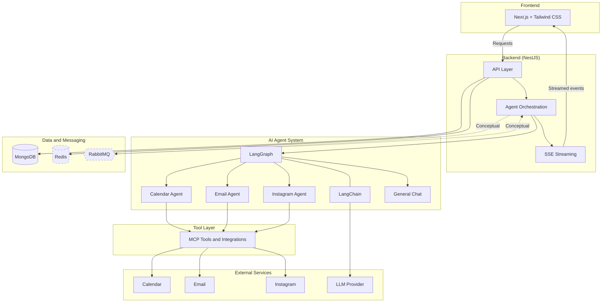

<div align="center">

# Sutra

**Delegate everyday digital tasks to specialized AI agents using natural language.**


</div>

---

## Introduction

Sutra is an AI-powered automation and productivity platform built around specialized AI agents. Instead of switching between calendars, inboxes, and social media tools, you describe what you want in plain language and Sutra's agents carry out the work. It also includes a general-purpose conversational assistant for everyday questions.

> **Project status:** Sutra is under active development. See [Development Status](#development-status) for details on what is implemented and what is planned.

## Table of Contents

- [Overview](#overview)
- [Features](#features)
- [How It Works](#how-it-works)
- [Architecture](#architecture)
- [Technology Stack](#technology-stack)
- [Project Structure](#project-structure)
- [Getting Started](#getting-started)
- [Environment Variables](#environment-variables)
- [Development Status](#development-status)
- [Roadmap](#roadmap)
- [Contributing](#contributing)
- [License](#license)

## Overview

### The problem

Routine digital work is fragmented. Scheduling a meeting means checking a calendar, drafting an email, and confirming details across several applications. Publishing a social media post means writing copy, formatting it, and using yet another tool. Each task is small, but the context switching adds up.

### The approach

Sutra treats these tasks as delegable. A user describes an outcome in natural language, and the platform routes the request to a specialized agent that has access to the tools it needs. Each agent focuses on one domain (calendar, email, Instagram), which keeps its behavior scoped and its tool access explicit.

## Features

> Implementation status of each capability should be confirmed against the codebase. The legend below is used throughout this README:
>
> ✅ Implemented · 🚧 In progress · 🗓️ Planned · ❔ Status to be confirmed

### 🤖 AI Agent System

- Specialized agents for distinct task domains
- Natural-language task execution
- Agent orchestration and workflow coordination
- Context-aware interactions

### 📅 Calendar and Meeting Automation

- Create and manage calendar events
- Schedule meetings from natural-language instructions
- Assist with meeting arrangements

### 📸 Instagram Automation

- Generate Instagram post content with AI
- Automate publishing workflows
- Delegate social media tasks to an agent

### ✉️ Email Automation

- Compose emails with AI
- Send emails from natural-language instructions
- Automate email-related workflows

### 💬 General AI Chat

- Conversational assistant for general questions
- Entry point to the platform's agent ecosystem

### Feature status

| Feature                 | Status |
| ----------------------- | :----: |
| General AI chat         |   ❔   |
| Agent orchestration     |   ❔   |
| Calendar and meetings   |   ❔   |
| Email automation        |   ❔   |
| Instagram automation    |   ❔   |

<!-- Replace each ❔ with ✅, 🚧, or 🗓️ to reflect the current state of the project. -->

## How It Works

At a high level, Sutra connects four layers:

1. **User interface.** The user sends an instruction through the web client, for example a request to schedule a meeting or draft an email.
2. **Backend.** The API receives the request, manages the conversation, and hands the task to the agent system.
3. **Agents.** Specialized agents, built with LangChain and orchestrated with LangGraph, decide which steps and tools are needed to complete the task.
4. **Tools and external services.** Agents reach external services through tools. These may be exposed via the Model Context Protocol.

### Agent orchestration with LangGraph

LangGraph is used to model agent behavior as a graph of steps and state. This lets a task move through stages such as interpreting the request, selecting a tool, executing it, and responding, with state carried between steps. This structure is what allows multi-step workflows to be coordinated and inspected rather than handled as a single opaque prompt.

### Tool access with MCP

The Model Context Protocol provides a standard way for agents to discover and call tools. In Sutra, MCP is intended to be the connection layer between agents and external capabilities such as calendar, email, and Instagram integrations.

### Streaming responses

Server-Sent Events (SSE) are used to stream responses and progress updates from the backend to the client, so users see output as it is produced.

> Specific orchestration flows, graph definitions, and tool contracts are documented separately as they are finalized.

## Architecture

The diagram below shows the **conceptual** relationship between components. Components drawn with dashed borders are conceptual and have not been confirmed as implemented.



### Component notes

| Component   | Role in Sutra                                                              |
| ----------- | -------------------------------------------------------------------------- |
| Next.js     | Web client for chat and agent interaction                                  |
| NestJS      | Backend API, request handling, and orchestration entry point               |
| LangChain   | LLM and tool abstractions used by agents                                   |
| LangGraph   | Stateful orchestration of multi-step agent workflows                       |
| MCP         | Standard interface between agents and external tools                       |
| MongoDB     | Persistent storage (for example conversations and user data)               |
| Redis       | Caching and short-lived state (exact usage to be confirmed)                |
| RabbitMQ    | Asynchronous messaging between services (exact usage to be confirmed)      |
| SSE         | One-way streaming of responses and progress to the client                  |

## Technology Stack

### Frontend

| Technology   | Purpose                                      |
| ------------ | -------------------------------------------- |
| Next.js      | React framework for the web client           |
| TypeScript   | Type-safe development                        |
| Tailwind CSS | Utility-first styling                        |

### Backend

| Technology | Purpose                                              |
| ---------- | ---------------------------------------------------- |
| NestJS     | Modular server-side framework                        |
| TypeScript | Shared language across the stack                     |
| Nx         | Monorepo tooling, task running, and project graph    |

### AI and Agent Architecture

| Technology | Purpose                                                  |
| ---------- | -------------------------------------------------------- |
| LangChain  | LLM integration and tool abstractions                    |
| LangGraph  | Graph-based agent orchestration and state management     |
| MCP        | Standardized connection between agents and external tools |

### Database and Caching

| Technology | Purpose                                  |
| ---------- | ---------------------------------------- |
| MongoDB    | Primary document database                |
| Redis      | Caching and ephemeral state              |

### Messaging and Real-Time Communication

| Technology | Purpose                                             |
| ---------- | --------------------------------------------------- |
| RabbitMQ   | Message broker for asynchronous workloads           |
| SSE        | Streaming responses from server to client           |

### Infrastructure

| Technology | Purpose                                                |
| ---------- | ------------------------------------------------------ |
| Docker     | Containerization and consistent local environments     |

## Project Structure

> **This is an example structure** for an Nx monorepo with a Next.js frontend and a NestJS backend. It does not reflect the actual repository layout. Update it to match the real project.

```text
sutra/
├── apps/
│   ├── web/                  # Next.js frontend
│   └── api/                  # NestJS backend
├── libs/
│   ├── agents/               # Agent definitions and LangGraph workflows
│   ├── tools/                # Tool definitions and MCP integrations
│   ├── shared/
│   │   ├── types/            # Shared TypeScript types
│   │   └── utils/            # Shared utilities
│   └── ui/                   # Shared UI components (optional)
├── docker/                   # Docker-related configuration
├── docs/                     # Additional documentation
├── .env.example
├── nx.json
├── package.json
└── README.md
```

## Getting Started

> Commands and values below use placeholders where project-specific information is not available. Replace them with the real values from the repository.

### Prerequisites

- Node.js (version: `<required-version>`)
- npm
- Docker and Docker Compose (for local services)
- Access to an LLM provider account (`<provider>`)
- Credentials for any external integrations you plan to use

### Installation

```bash
# 1. Clone the repository
git clone https://github.com/<your-username>/<repository-name>.git
cd <repository-name>

# 2. Install dependencies
npm install

# 3. Create your environment file
cp .env.example .env
# Then edit .env and fill in your own values
```

### Start supporting services

MongoDB, Redis, and RabbitMQ can be run locally with Docker. The exact command depends on the project's Docker configuration:

```bash
docker compose up -d   # <adjust to the actual compose file and service names>
```

### Run in development

Nx runs each application by its project name:

```bash
# Backend
npx nx serve <backend-project-name>

# Frontend
npx nx serve <frontend-project-name>   # or: npx nx dev <frontend-project-name>
```

The ports the applications listen on are `<backend-port>` and `<frontend-port>`. Check each project's configuration to confirm them.

### Build and test

```bash
npx nx build <project-name>
npx nx test <project-name>
npx nx run-many -t build   # build all projects
```

## Environment Variables

The following `.env.example` is a **template with placeholder names and values**. Variable names are illustrative; align them with the names the code actually reads. Never commit real credentials.

```bash
# ─── Application ───────────────────────────────────────────
NODE_ENV=development
APP_URL=<frontend-url>
API_URL=<backend-url>

# ─── MongoDB ───────────────────────────────────────────────
MONGODB_URI=<your-mongodb-connection-string>

# ─── Redis ─────────────────────────────────────────────────
REDIS_URL=<your-redis-connection-string>

# ─── RabbitMQ ──────────────────────────────────────────────
RABBITMQ_URL=<your-rabbitmq-connection-string>

# ─── AI Provider ───────────────────────────────────────────
AI_PROVIDER_API_KEY=<your-ai-provider-api-key>
AI_MODEL=<model-name>

# ─── Calendar Integration ──────────────────────────────────
CALENDAR_CLIENT_ID=<your-calendar-client-id>
CALENDAR_CLIENT_SECRET=<your-calendar-client-secret>

# ─── Email Integration ─────────────────────────────────────
EMAIL_CLIENT_ID=<your-email-client-id>
EMAIL_CLIENT_SECRET=<your-email-client-secret>

# ─── Instagram Integration ─────────────────────────────────
INSTAGRAM_APP_ID=<your-instagram-app-id>
INSTAGRAM_APP_SECRET=<your-instagram-app-secret>

# ─── Authentication / Security ─────────────────────────────
AUTH_SECRET=<your-generated-secret>
```

> Make sure `.env` is listed in `.gitignore`.

## Development Status

Sutra is **currently in development** and is not yet production-ready. APIs, data models, and agent behavior may change without notice.

| Area                          | Status |
| ----------------------------- | :----: |
| Core platform (web and API)   |   ❔   |
| Agent orchestration           |   ❔   |
| General AI chat               |   ❔   |
| Calendar and meeting agent    |   ❔   |
| Email agent                   |   ❔   |
| Instagram agent               |   ❔   |
| Streaming responses (SSE)     |   ❔   |

<!-- Update the table to reflect reality: ✅ Implemented · 🚧 In progress · 🗓️ Planned -->

## Roadmap

The roadmap is directional and may change as the project evolves.

**Foundation**
- [ ] Stable monorepo setup with shared types and tooling
- [ ] Authentication and user accounts
- [ ] Conversation persistence

**Agent platform**
- [ ] Robust LangGraph workflows with state handling and error recovery
- [ ] Standardized MCP tool layer for integrations
- [ ] Human-in-the-loop confirmation before sensitive actions (sending email, publishing posts)
- [ ] Observability for agent runs (logging and tracing)

**Integrations**
- [ ] Calendar and meeting scheduling
- [ ] Email composition and sending
- [ ] Instagram content generation and publishing
- [ ] Additional integrations based on user needs

**Quality and operations**
- [ ] Automated tests across apps and libraries
- [ ] CI pipeline
- [ ] Production-oriented Docker setup
- [ ] Documentation for adding new agents and tools

## Contributing

Contributions are welcome. A typical workflow:

1. **Fork** the repository.
2. **Create a branch** for your change:
   ```bash
   git checkout -b feature/<short-description>
   ```
3. **Make your changes**, following the existing code style and adding tests where appropriate.
4. **Run checks** locally:
   ```bash
   npx nx run-many -t lint test build
   ```
5. **Commit** with a clear message:
   ```bash
   git commit -m "feat: short description of the change"
   ```
6. **Push** your branch and **open a pull request** describing what changed and why.

For significant changes, please open an issue first to discuss the approach. Do not include real credentials, tokens, or personal data in commits or issues.

## License

No license has been selected for this project yet.

<!-- Add a LICENSE file and update this section and the badge at the top once a license is chosen. -->

---

<div align="center">

**Sutra** · Natural-language automation through specialized AI agents

</div>
